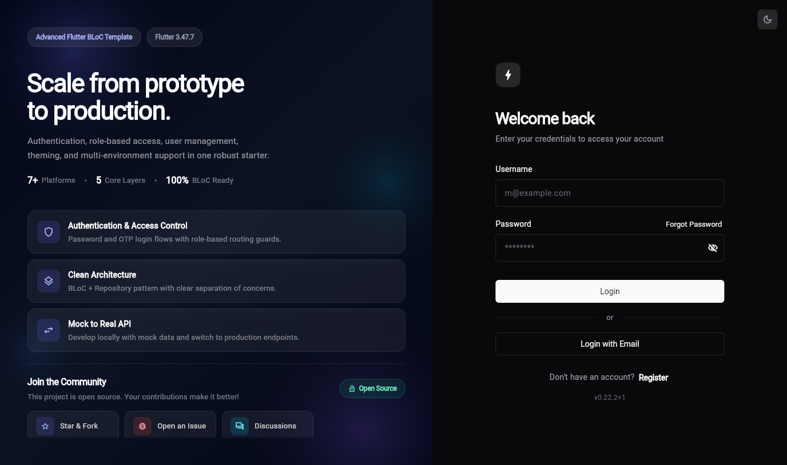
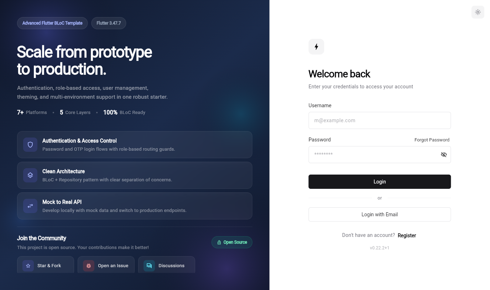
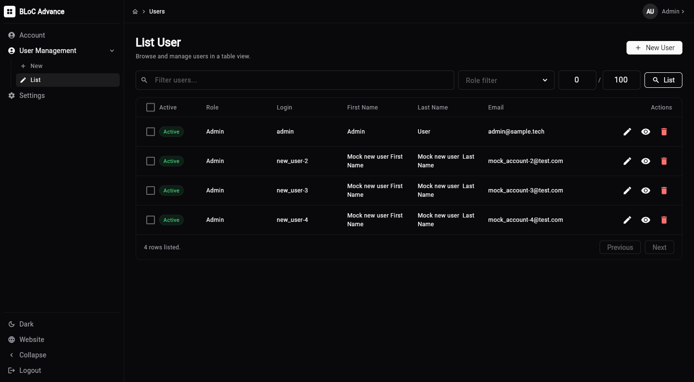
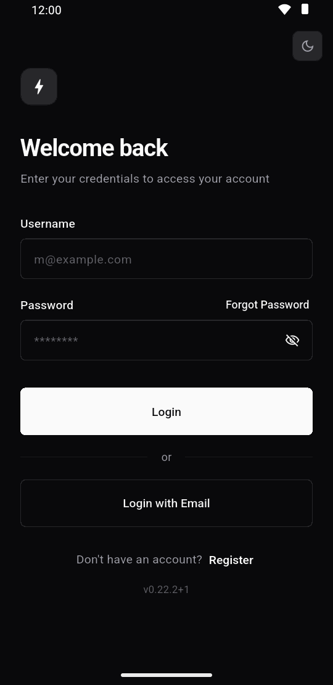
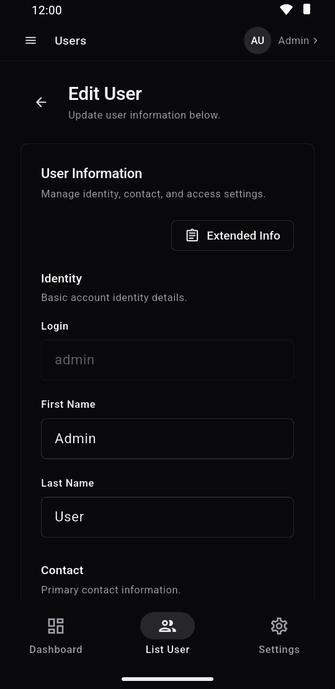
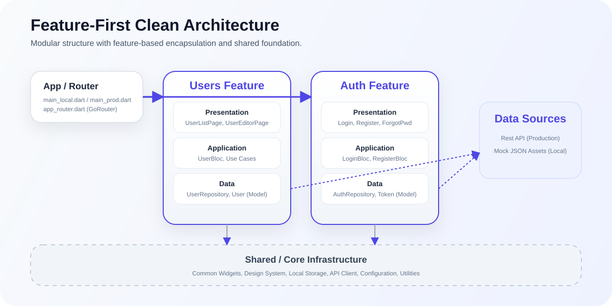

# Advanced Flutter BLoC Template

[](https://opensource.org/licenses/MIT)


A production-ready, community-friendly Flutter starter built with BLoC, repository pattern, responsive UI, role-based access control, internationalization, and multi-environment support. It is designed to help you move from prototype to maintainable product faster across mobile, web, and desktop.

**Useful links:** [Live Demo](https://cevheri.github.io/flutter-bloc-advanced/) · [Wiki](https://deepwiki.com/cevheri/flutter-bloc-advanced) · [Transformation Log](docs/archived/clean-modernize-strengthen.md) · [Report an Issue](https://github.com/cevheri/flutter-bloc-advanced/issues) · [Contributing](#contributing)

## Why This Template?

- Production-oriented structure with clear separation between presentation, business logic, and data access.
- Ready-to-use authentication, role-based routing, user management, localization, theming, and dashboard flows.
- Local mock mode for rapid development and production mode for real API integration.
- Works as an open-source base project for teams, side projects, internal products, and community contributions.

## Screenshots

The screenshots below are included to help contributors and adopters understand the current UX quickly before cloning or running the project.

### Web Experience

| Dark Login | Light Login |
| --- | --- |
|  |  |



### Mobile Experience

| Login | Edit User |
| --- | --- |
|  |  |

## What You Get Out of the Box

### Authentication

- Login with username and password
- Registration flow
- Forgot password flow
- OTP send and verify flow
- **Single sign-on (opt-in)**: the sign-in method is chosen at build time with `AUTH_PROVIDER`.
  `jwt`, the default, is the password and OTP sign-in above against the template's backend, and `oidc` signs users in through any OpenID Connect provider, such as Keycloak, Zitadel, Auth0 or Microsoft Entra ID.
  See [Single Sign-On](#single-sign-on-oidc-opt-in) and [docs/oidc.md](docs/oidc.md).
- **Token storage** — JWT and refresh tokens are persisted via `flutter_secure_storage`
  (iOS Keychain, Android custom AES-GCM ciphers). Keychain accessibility is pinned to
  `first_unlock_this_device` so tokens stay on the device (no iCloud Keychain sync).
  Non-secret session fields (`username`, `roles`) remain in `SharedPreferences` for
  synchronous access. The first launch after upgrading from an older build runs a one-shot
  migration from the legacy plaintext keys into secure storage.
- **macOS keychain**: on macOS the tokens live in the login keychain, because the data protection keychain needs an Apple Developer team and a provisioning profile, and the default macOS build is signed ad hoc without them.
  The login keychain protects the tokens with an access control list that names the app, and keychain accessibility such as `first_unlock_this_device` does not apply there, so none is set on macOS.
  An ad-hoc signature names the app by its code hash, so after a rebuild macOS asks for the login keychain password before the app can read the stored session.
  Startup waits at most 10 seconds for the keychain in the session migration, then at most 10 seconds more in the session restore, and shows the login page if the password has not been entered by then; the stored session still opens once it is.
  With a team and a provisioning profile you can move to the data protection keychain: add `keychain-access-groups` to both `macos/Runner/*.entitlements` files and set `usesDataProtectionKeychain: true` and `accessibility: KeychainAccessibility.first_unlock_this_device` in `FlutterSecureStorageAdapter` (`lib/infrastructure/storage/secure_storage.dart`); users then sign in once more.

### User Management

- Create, update, delete, and list users
- Account profile view and update
- Change password screen

### Access Control

- Role-based routing for Admin and User roles
- Public and private route separation
- Protected admin-only pages

### Crash Reporting (Sentry, opt-in)

The template ships with a Sentry adapter (`SentryAnalyticsService`) and a conservative PII / token scrubber, but **no DSN is committed** — public templates with a committed DSN bleed events from every fork into the original project's quota. Provide a DSN at build time:

```shell
fvm flutter run --target lib/main/main_prod.dart \
  --dart-define=SENTRY_DSN=https://YOUR_PUBLIC_KEY@oXXX.ingest.sentry.io/YOUR_PROJECT_ID
```

```shell
fvm flutter build apk --release --target lib/main/main_prod.dart \
  --dart-define=SENTRY_DSN=https://...
```

- **No DSN, or non-prod build:** `AppDependencies.createAnalyticsService()` returns `LogAnalyticsService`. Errors land in `AppLogger`. No network egress.
- **DSN + prod build:** bootstrap calls `SentryFlutter.init(...)` and the analytics interface switches to the Sentry-backed implementation. `SentryNavigatorObserver` registers automatically so route changes become breadcrumbs.
  Screen views add no breadcrumb of their own, so each navigation is recorded once.

`sentryBeforeSend` (see `lib/infrastructure/analytics/sentry_scrub.dart`) drops the following before any event leaves the device:

- `Authorization` / `Cookie` / `Set-Cookie` headers (case-insensitive)
- The whole value of any other header whose name contains `password`, `otp`, `token`, `secret`, `authorization` or an api-key name (`api-key`, `api_key`, `apikey`), or is an OpenID Connect key, such as `X-Auth-Token`, `Proxy-Authorization` or `X-Api-Key`, replaced with `[REDACTED]`
- The whole value of a tag named the same way as a credential body key, and email addresses, JWTs and the secrets `maskSecrets` finds in every other tag value
- Email addresses, JWTs and the secrets `maskSecrets` finds in the user's id, username, email, IP address and name, and the user's data masked like a breadcrumb's data
- Email addresses, JWTs and the secrets `maskSecrets` finds (see the last item) in every other request header value and every `request.env` value; the header names are kept
- The values of body keys whose names contain `password`, `otp`, `token` or `secret` (case-insensitive substring), at any depth, replaced with `[REDACTED]`
- Email addresses and JWT-shaped strings (3 base64url segments) in exception values, the event message and the request body (which only an HTTP integration a fork adds, such as `sentry_dio`, attaches), replaced with `[REDACTED_EMAIL]` / `[REDACTED_JWT]`
- Email addresses and JWTs in the page location (`request.url`, query string, fragment) and the transaction name, replaced with `[REDACTED_EMAIL]` / `[REDACTED_JWT]`.
  On web the OTP route `/login-otp-verify/:email` puts the user's email there.
- In the same text, the value of a JSON member or a `name=value` pair whose name contains one of those words, and the credentials of a `Bearer` authorization, replaced with `[REDACTED]` by `maskSecrets`, which `AppLogger` also runs over every line it prints.

`sentryBeforeBreadcrumb`, the `beforeBreadcrumb` hook, masks email addresses, JWTs and the secrets `maskSecrets` finds in the message and the data of every breadcrumb when it is recorded, and the value of every credential key of the data: the breadcrumbs of `SentryAnalyticsService` and the navigation breadcrumbs.
It also covers the http and ui breadcrumbs a fork adds through `sentry_dio` or `SentryUserInteractionWidget`.
`installSentryScrubbers` installs both hooks, and `configureSentryOptions` (`lib/app/bootstrap/sentry_start.dart`), the options `AppBootstrap.run` starts Sentry with, calls it.
It also turns print breadcrumbs off, so no printed line, and no `AppLogger` line, becomes a breadcrumb.
On web the SDK runs the app in a zone that made a breadcrumb of every printed line, and a scrubber cannot find a password or a code in free text.
Native builds never recorded `AppLogger` lines.

The native Sentry SDKs record breadcrumbs and send events of their own (activity and app lifecycle, system events, Java and Kotlin exceptions, ANR events, native crash reports), and none of them pass through the Dart hooks.
On Android the host app starts sentry-android itself (`MainApplication.kt` and `NativeSentry.kt` under `android/app/src/main/kotlin`) with `beforeSend` and `beforeBreadcrumb` hooks that mask them with a Kotlin copy of the same rules (`NativeSentryScrubber.kt`), and the Dart side turns `autoInitializeNativeSdk` off on Android only.
`test/architecture/sentry_native_scrub_patterns_test.dart` fails when the Kotlin patterns drift from the Dart ones, and the fixtures in `test/fixtures/` run in the Dart tests and in the Android JVM unit tests (`cd android && ./gradlew :app:testDebugUnitTest -Ptarget=lib/main/main_prod.dart`).
Gradle needs JDK 17 there, and the Gradle wrapper is not committed: any Flutter Android build writes it, for example `fvm flutter build apk --config-only --target lib/main/main_prod.dart`.
The lifecycle breadcrumbs of sentry-android keep their `state` (such as `resumed` or `foreground`); a copy that Sentry merges into a Dart event still shows it masked.

| Platform | Dart events and breadcrumbs | Native breadcrumbs | Native events and crash reports |
| --- | --- | --- | --- |
| Android | Scrubbed | Scrubbed | Scrubbed |
| iOS | Scrubbed | Not scrubbed | Not scrubbed |
| macOS | Scrubbed | Not scrubbed | Not scrubbed |
| Linux, Windows | Scrubbed | None recorded | Minidumps, which cannot be scrubbed |
| Web | Scrubbed | Not applicable | Not applicable |

Native scrubbing is not done on iOS and macOS yet: sentry_flutter starts sentry-cocoa there, and what it records itself leaves the device unmasked.
On Linux and Windows sentry-native records no breadcrumbs of its own, but a native crash uploads a minidump, a copy of process memory that no text scrubber can clean; set `options.enableNativeCrashHandling = false` for those platforms in `configureSentryOptions` if that is not acceptable.
Sentry's server-side data scrubbing (Advanced Data Scrubbing in the project settings) is a useful complement on every platform, but it runs after the data has left the device, so it does not replace the hooks.

On Android, Gradle passes the DSN to the native SDK only for a `lib/main/main_prod.dart` build (`android/app/build.gradle.kts`), the only entry point that selects the prod environment in which the Dart side starts Sentry.
A fork that renames that entry point changes the check there too; when the two disagree, or the host app does not answer the check, the app throws a `StateError` at start in a debug or profile build, and a release build logs the error and runs exactly as without a DSN: no Sentry SDK and the log-only analytics.
A native option set on the Dart side in `configureSentryOptions` does not reach the Android SDK, so set it in `NativeSentry.kt` as well; Session Replay would need its recorder wired there before it can be turned on.

The scrubber is unit-tested independently of the SDK; review it against your fork's PII surface before adopting in production. Adding new redaction rules is a single-file change.

Default sample rate: `tracesSampleRate: 0.2`. Adjust in `configureSentryOptions` if your event budget needs different cadence.

### Certificate Pinning (opt-in)

The HTTP client supports certificate pinning to defend against MITM via user-installed root CAs, rogue intermediates, and other forms of device-trust-store compromise. **Default off** — the template ships with an empty pin list because pinning the wrong cert bricks every install.

How it works:

- `AppConfig.certificatePins` (`lib/infrastructure/config/environment.dart`) is a `List<String>` of base64 SHA-256 hashes. Empty list = pinning disabled (use system trust); non-empty list installs a custom Dio adapter that uses `SecurityContext(withTrustedRoots: false)` so **every** certificate falls through `badCertificateCallback` for pin checking. This is the only correct way to enforce pinning even against system-trusted but adversarial CAs.
- A pin mismatch fails the TLS handshake with a `CertificatePinningException` (`lib/infrastructure/http/certificate_pinner.dart`), so dio reports `DioExceptionType.unknown` with that exception as its `error`, not `DioExceptionType.badCertificate` (dio raises that only for `IOHttpClientAdapter.validateCertificate`).
  `ResilienceInterceptor` neither retries it nor counts it toward opening the endpoint's circuit.
  `CacheInterceptor` never answers it from cache: the connection may be intercepted, so the request fails instead of showing earlier data.
  Retries and the token-refresh call go through the same pinned adapter as the original request.
  `ApiClient` throws it as an `UntrustedCertificateException` (`lib/core/errors/app_api_exception.dart`), a `FetchDataException` whose message names the host and port for the log.
  `LoginRepository`, `AccountRepository`, `UserRepository`, `AuthorityRepositoryImpl`, `DynamicFormRepository` and `LifecycleRepository` report it as an `AppError` with the `AppErrorCode.networkCertInvalid` key.
  The sign-in, OTP, registration, password reset, change password and account screens, the user list and editor, and the dynamic form pages show its translated message instead of the exception text.
  The roles field of the user list and editor still says "Roles unavailable" without the reason.
- No other TLS failure is answered from cache either, pinning or not: a certificate the device does not trust (expired, self-signed, a wrong device clock, a captive portal or an intercepting proxy), a hostname mismatch, or a handshake closed before it completed ("Connection terminated during handshake") fails the request.
  A dropped network can close a handshake too, but so can anything between the device and the server, so that case fails closed as well.
  A handshake reset before it completed is a connection error instead, which the cache answers like a lost connection.
  `CacheInterceptor` answers a GET from cache only when it cannot reach the server: a connection error, a timeout, or a connection closed or reset before the whole response arrived; a response that dart:io cannot parse counts too.
  `ApiClient` throws such a failure, and a certificate that `IOHttpClientAdapter.validateCertificate` rejects (`DioExceptionType.badCertificate`), as an `UntrustedCertificateException` too, so the screens above show the same translated message; the exception message keeps the TLS error for the log.
  `ResilienceInterceptor` does not count it toward opening the endpoint's circuit, so a circuit-open error never replaces it.
  On web the browser reports a TLS failure as a connection error, so there it cannot be told apart from a lost connection.
- **Web platform is a hard no-op.** Browsers control TLS; from JS we cannot intercept the handshake. Use HSTS / CT pinning at the server side instead.

Extract pins from your live backend:

```shell
openssl s_client -servername api.example.com -connect api.example.com:443 < /dev/null 2>/dev/null \
  | openssl x509 -outform DER \
  | openssl dgst -sha256 -binary \
  | openssl enc -base64
```

(**v1 caveat — full-cert hash, not SPKI.** The OWASP-recommended pin is `SHA-256(SubjectPublicKeyInfo)`, which survives certificate rotation as long as the keypair is reused. Extracting SPKI from X.509 DER requires ASN.1 parsing; we ship full-cert hash for simplicity and auditability. Stored pin shape stays identical when upgrading — only the hash input changes. Track this gap in your fork before adopting in production.)

Key rotation procedure:

1. Add the new (backup) pin to `certificatePins` **before** rotating server keys. Ship that app version.
2. Rotate server certs to the new keypair.
3. In a later release, remove the old pin.

This avoids a window where in-flight users with the old app version cannot reach the new cert.

### Single Sign-On (OIDC, opt-in)

A build with `AUTH_PROVIDER=oidc` replaces the password sign-in with a single "Sign in with SSO" button that signs the user in through an OpenID Connect provider.
The app is a public client: it uses the Authorization Code flow with PKCE (S256), keeps no client secret, holds the provider's tokens in secure storage, and sends the provider's access token to the backend as the bearer.
Without `AUTH_PROVIDER`, or with `AUTH_PROVIDER=jwt`, the app behaves exactly as before and never calls the OIDC code.

```shell
fvm flutter run --target lib/main/main_prod.dart \
  --dart-define=AUTH_PROVIDER=oidc \
  --dart-define=OIDC_ISSUER=https://id.example.com/realms/acme \
  --dart-define=OIDC_CLIENT_ID=acme-app \
  --dart-define=OIDC_ROLE_CLAIM=realm_access.roles
```

- **Every platform:** Android through a Custom Tab, iOS and macOS through `ASWebAuthenticationSession`, web in the same tab through `web/redirect.html`, and Linux and Windows through the system browser with a loopback redirect.
- **Roles** come from a claim of the ID token (`OIDC_ROLE_CLAIM`, `OIDC_ADMIN_ROLES`, `OIDC_USER_ROLES`) and map to `ROLE_ADMIN` and `ROLE_USER`.
- **Refresh** goes to the provider's token endpoint through the same `TokenRefreshInterceptor`, and a logout the user starts also ends the session at the provider.
- **Registration, forgot password, OTP sign-in and change password** belong to the provider, so their routes and entry points are left out.

Try it locally with the bundled Keycloak demo, which needs no backend because `main_local.dart` answers API calls from the mock data:

```shell
docker compose -f tool/oidc-demo/docker-compose.yml up -d --wait
fvm flutter run -d chrome --web-port 8081 --target lib/main/main_local.dart --dart-define-from-file=tool/oidc-demo/oidc-demo.env
```

Sign in as `admin` / `admin` or `user` / `user`, and stop the demo with `docker compose -f tool/oidc-demo/docker-compose.yml down -v`.
[docs/oidc.md](docs/oidc.md) has the provider setup for Keycloak, Zitadel, Auth0 and Entra ID, the configuration reference, the backend contract with Next.js and Spring Boot examples, troubleshooting and the known limitations.

### Inactivity Auto-Logout

`IdleTimeoutObserver` (`lib/core/security/`) signs the user out after a configurable window of inactivity. Default threshold is **15 minutes** in production, **disabled** in dev/test (where hot-reload + mocked sessions would make a 15-minute kick out hostile).

- Configured via `AppConfig.idleTimeout` in `lib/infrastructure/config/environment.dart`: `AppConfig.prod()` sets 15 minutes, `AppConfig.dev()` and `AppConfig.test()` set `null`, which disables it.
- Background-aware: on iOS the Dart `Timer` pauses while the app is suspended, so the observer also captures wall-clock `DateTime.now()` on lifecycle transitions; resumes past the threshold fire immediately.
- Browser tabs: on web all tabs of the app share one session, and an idle timeout in any tab signs out every tab.
  So each tab records its latest activity in `localStorage` while it is in the foreground, at most once every 10 seconds, and before a tab signs out, from its timer or when the user returns to it, it checks the latest activity of every tab.
  Returning to a tab left idle does not sign out the session the user is working in, in another tab.
  Activity can reach the other tabs up to 10 seconds late, so the session can end up to 10 seconds early.
- Surfacing: when the timer fires, the user sees a localized snackbar ("You were signed out due to inactivity.") and the router redirects to login. The reason is tagged `SessionExpiredReason.idleTimeout` so logs and UI can distinguish it from a manual sign-out.
- Activity scope: a touch, click or drag, mouse wheel and trackpad scrolling, and key presses reset the timer, so a user who only scrolls a long page or only types in a form stays signed in.
  Moving the mouse without a button pressed does not count, and neither do key events Flutter synthesizes to match the keyboard state.

Compliance baselines that expect inactivity timeouts: SOC2 CC6.1, ISO 27001 A.9.4.2, GDPR Art. 32.

### Maintenance Mode and Forced Updates

At startup the app reads `GET /app/config`, a public endpoint that needs no session (mock: `assets/mock/GET_app_config.json`).
`LifecycleGate` (`lib/features/lifecycle/`) sits in the `MaterialApp` builder, around the session restore and the router, and shows a full-screen page in their place when the config asks for one.

- `maintenanceMode: true` shows the maintenance screen with the config's `maintenanceMessage` (or a translated default), the `maintenanceEstimatedEnd` time in the user's language and time zone, and a retry button.
- A `minimumVersion` above the installed version shows the update screen, which opens the `storeUrl` when it is an https link.
- The app checks again when it comes back to the foreground, at most once every 5 minutes (`LifecycleBloc.defaultRecheckInterval`).
- Fail open: when the endpoint is missing or the request fails, the app opens normally and the failure is logged as an error.
  An untrusted certificate is reported with `AppErrorCode.networkCertInvalid`.
  A failed re-check keeps a maintenance or update screen the server already asked for, so a server error or a lost connection does not let the user skip a required update.
- A non-empty `featureFlags` map in the config replaces the flags in `FeatureFlagService`.

### Idempotent Mutations (opt-in)

`ResilienceInterceptor` retries a transient failure (timeout, connection error, 502/503/504) only when the request is safe to send twice.
`GET`, `HEAD`, `OPTIONS`, `PUT` and `DELETE` are idempotent by HTTP semantics and are retried.
A `POST` or `PATCH` may already have been processed by the server, so it is retried only when it carries an `Idempotency-Key` header; without one, the caller gets the error.
The template ships an opt-in `IdempotencyInterceptor` that attaches an `Idempotency-Key: <uuid-v4>` header so a properly configured backend can deduplicate.

**The header is a contract, not a guarantee.**
The server must be configured to deduplicate by this header (see Stripe's worked example, IETF draft `idempotency-key-header`).
If the backend ignores it, opting in is worse than leaving it off: the key is what lets `ResilienceInterceptor` retry a `POST` or `PATCH`, and every retry the server processes creates another record.
Confirm support before opting in production call sites.

Opt in per call:

```dart
await apiClient.post<User>('/admin/users', user, idempotent: true);
await apiClient.put<User>('/admin/users', user, pathParams: '42', idempotent: true);
await apiClient.patch<User>('/admin/users', user, pathParams: '42', idempotent: true);
```

Worked example: `UserRepository.create` opts in (see `lib/features/users/data/repositories/user_repository.dart`).

**Retry stability:** once generated, the key is stashed on `RequestOptions.extra['_idempotency_key']` and reused on every subsequent pass — covers both `ResilienceInterceptor` retries (transient 5xx) and `TokenRefreshInterceptor` re-submission after a 401 + refresh.

`GET`, `HEAD`, `OPTIONS`, `DELETE` never get the header (safe / idempotent by HTTP semantics).

### Response Cache and Offline Data

`CacheInterceptor` stores successful `GET` responses and answers from them by the request's `CachePolicy` (`options.extra['cachePolicy']`, `networkFirst` by default):

| Policy | Behavior |
| --- | --- |
| `networkFirst` | Sends the request; answers from the cache only when the server cannot be reached |
| `cacheFirst` | Answers from a fresh entry without sending the request; otherwise behaves as `networkFirst` |
| `cacheOnly` | Answers from a fresh entry or fails with "No cached data available"; it never reaches the network, so neither being offline nor an open circuit stops it |
| `networkOnly` | Never reads or writes the cache |

An entry is fresh for its TTL, 5 minutes unless `options.extra['cacheTtl']` sets another.
Past its TTL an entry still answers a `GET` that cannot reach the server, with an `x-cache: stale` header, until it is 24 hours old (`CacheEntry.maxStaleAge`).
An entry read after that is deleted instead.
Ending the session, by a logout, the idle timeout or a token that cannot be refreshed, deletes every entry, and a clear that leaves some behind is logged as an error.
The response of a `GET` still on its way when the session ends is not stored, so it cannot answer the next user with the previous user's data.
The entries live in `SharedPreferences`, which on web is `localStorage`, whose per-origin quota the stored session and the preferences share.
So `SharedPrefsCacheStorage` evicts: when it starts and before each write it deletes the entries past 24 hours, and before each write it deletes the oldest entries until the new one fits in 200 entries and 1,000,000 characters.
A write the store refuses, such as one past the quota, is logged as an error with the key and the size, the entry is not cached, and the `GET` still succeeds.
A `GET` cannot reach the server when the device is offline, or when the connection is refused, times out, or is closed or reset before the whole response arrived.
A response that dart:io cannot parse, such as one from a server that does not answer in HTTP, counts the same way, since dart:io reports it like a connection reset while the response is awaited.
Every other failure reaches the caller, a server error or a TLS failure included: an untrusted certificate is never answered from the cache (see [Certificate Pinning](#certificate-pinning-opt-in)).
So does an open circuit: after repeated failures `ResilienceInterceptor` refuses the requests to that endpoint for 30 seconds, and a `GET` fails with `CircuitBreakerOpenException` even when a response is cached.
An answer from a fresh `cacheFirst` or `cacheOnly` entry carries `x-cache: hit`.

### Screen Capture Protection (opt-in)

Mechanism for sensitive screens (credentials, OTP, payment, tokens) shipped **disabled by default**. The template's job is to provide the hook, not impose UX on every fork — many apps legitimately want users to screenshot QR codes, receipts, etc.

- Helper: `ScreenCaptureProtection.enable()` / `.disable()` in `lib/core/security/screen_capture_protection.dart`.
- Per-screen mixin: `ScreenCaptureProtected<T>` in `lib/core/security/screen_capture_protected.dart` — add to a `State<T>` and it auto-enables on `initState`, releases on `dispose`.

Platform behaviour (**asymmetric — read this**):

| Platform | What happens |
| --- | --- |
| Android | `FLAG_SECURE`: screenshots and screen recording are blocked; recent-apps preview renders black. |
| iOS | iOS provides no API to block screenshots (Apple policy). The task-switcher snapshot is **blurred** so on-screen secrets do not leak into the app preview. Screenshots while foregrounded still succeed. |
| Web / Desktop | No-op. |

Opt-in example (uncomment in `LoginScreen`):

```dart
import 'package:flutter_bloc_advance/core/security/screen_capture_protected.dart';

class _LoginScreenState extends State<LoginScreen>
    with ScreenCaptureProtected<LoginScreen>, SingleTickerProviderStateMixin {
  // ...
}
```

When to enable: credential entry, OTP screens, token display.
When not to enable: screens with content the user is expected to capture (QR codes, receipts).

### Server-Driven Dynamic Forms

- 16 supported field types: text, email, password, number, phone, textarea,
  dropdown, multiSelect, date, datetime, toggle, checkbox, radio, slider,
  sectionHeader, divider
- Schema-only loading (`/dynamic-forms/sample` — CRM lead demo) or bundled
  `{schema, values}` loading with per-instance `pathParams`
  (`/user/:id/extended-info` — user extended-info kitchen-sink covering all 16
  types)
- Reusable from any feature via `DynamicFormsFeatureRoutes.withBloc(context, child)`
  — the engine lives under `shared/dynamic_forms/` and is feature-agnostic

### UI and Developer Experience

- Dark and light themes
- Responsive layout support
- English and Turkish localization
- Design system foundation with reusable components
- Multi-platform support for Android, iOS, Web, macOS, Linux, and Windows

### Architecture

- BLoC for state management
- Feature-First Clean Architecture with domain layer (entities + repository interfaces)
- Use Cases for business logic isolation
- Repository pattern with `Result<T>` sealed type (no raw exceptions)
- Typed error hierarchy (`NetworkError`, `AuthError`, `ValidationError`, `ServerError`, etc.)
- Dio HTTP client with interceptor chain (auth, logging, mock)
- Feature-based routing with clean boundaries
- Manual JSON serialization for models
- Environment-driven configuration for local and production modes
- Architecture guard tests enforcing dependency rules



## Quick Start

### Prerequisites

- Flutter `3.47.7` and Dart `3.13.5`
- [FVM](https://fvm.app/documentation/getting-started/installation) recommended for version consistency
- Android SDK for Android builds
- Xcode for iOS and macOS builds
- Minimum deployment targets: Android 8.0 (API 26), iOS 15, macOS 12

### Install FVM

```shell
# macOS / Linux
brew tap leoafarias/fvm
brew install fvm

# Windows
choco install fvm
```

### Setup

```shell
git clone https://github.com/cevheri/flutter-bloc-advanced.git
cd flutter-bloc-advanced

fvm install 3.47.7
fvm use 3.47.7
fvm flutter pub get
```

### Run Locally With Mock Data

All local requests use `assets/mock/`, so you can explore the app without standing up a backend first.

```shell
# Mobile
fvm flutter run --target lib/main/main_local.dart

# Web
fvm flutter run -d chrome --target lib/main/main_local.dart

# Web with a specific port
fvm flutter run -d chrome --web-port 3000 --target lib/main/main_local.dart
```

### Demo Credentials

| Role | Username | Password | Access |
| --- | --- | --- | --- |
| Admin | `admin` | `admin` | All pages |
| User | `user` | `user` | Own profile and settings |

### Run Against the Real API

```shell
# Mobile
fvm flutter run --target lib/main/main_prod.dart

# Web
fvm flutter run -d chrome --target lib/main/main_prod.dart
```

The production environment is configured in `lib/infrastructure/config/environment.dart`.

## Tech Stack

| Category | Technology |
| --- | --- |
| Flutter | 3.47.7 |
| Dart | 3.13.5 |
| State Management | flutter_bloc 9.1.1, bloc_concurrency 0.3.0, stream_transform 2.1.2 |
| Routing | go_router 18.1.1 |
| HTTP | dio 5.11.1 (interceptor chain: connectivity, auth, token-refresh, idempotency, resilience, cache, dev-console, logging, mock (dev/test only)) |
| Forms | flutter_form_builder 10.3.0+2 |
| Localization | intl 0.20.3, intl_utils 2.8.17 |
| Storage | shared_preferences 2.5.6, flutter_secure_storage 11.2.0 |
| Testing | flutter_test, bloc_test, mocktail |

## Project Structure

```text
lib/
  app/                 # Application foundation
    di/                # Dependency injection (manual, no get_it)
    router/            # Centralized routing with go_router
    shell/             # Responsive shell (sidebar, top bar, bottom nav, command palette)
    theme/             # Theme management
  core/                # Zero-dependency foundation
    errors/            # AppError sealed hierarchy + API exceptions
    result/            # Result<T> sealed type (Success / Failure)
    logging/           # Structured logging (AppLogger)
    security/          # JWT utilities
  features/            # Feature-based clean architecture modules
    <feature>/
      application/     # BLoCs, Use Cases
      data/            # Models, Repositories (concrete implementations)
      domain/          # Entities, Repository interfaces
      navigation/      # Feature-specific routes
      presentation/    # Pages and feature-specific widgets
  infrastructure/      # Cross-cutting technical concerns
    config/            # Environment, TemplateConfig
    http/              # Dio ApiClient + interceptors (auth, logging, mock)
    storage/           # Local storage (SharedPreferences)
  shared/              # Shared foundation across features
    design_system/     # Theme, typography, color tokens, 13 components
    dynamic_forms/     # Server-driven form engine (16 field types, bundle load, public withBloc helper)
    models/            # Cross-feature entities (UserEntity)
    widgets/           # Reusable components (buttons, forms, dialogs)
  generated/           # Localization generated files (do not edit)
  l10n/                # ARB translation files
  main/                # Entry points (main_local.dart, main_prod.dart)

test/                  # Mirrors lib/ structure
  architecture/        # Import guard tests (dependency rule enforcement)
  features/            # Feature tests (application, data, presentation)
  mocks/               # Mock classes and fake data
```

## Customizing for Your Project

All template placeholders use `__KEYWORD__` naming. Run a **global search** for `__` across the project, replace each keyword with your own value, and you are done.

| Keyword | Description | Example | Where Used |
| --- | --- | --- | --- |
| `__APP_NAME__` | Full application name | `Acme Dashboard` | template_config.dart, manifest.json, 404.html |
| `__APP_SHORT_NAME__` | Short name (PWA, mobile) | `Acme` | manifest.json |
| `__APP_DESCRIPTION__` | One-line app description | `Team collaboration platform` | manifest.json |
| `__PROD_API_URL__` | Production API endpoint | `https://api.acme.com/v1` | template_config.dart, index.html |
| `__WEB_BASE_URL__` | Deployment URL (trailing `/`) | `https://app.acme.com/` | index.html, sitemap.xml, robots.txt, .well-known/security.txt |
| `__WEB_BASE_PATH__` | Path of the deployment URL (leading and trailing `/`) | `/` | 404.html, robots.txt |
| `__GITHUB_REPO_URL__` | GitHub repository URL (no trailing `/`) | `https://github.com/acme/dashboard` | template_config.dart, .well-known/security.txt |
| `__DOCS_URL__` | Documentation website | `https://docs.acme.com` | template_config.dart |
| `__SPONSOR_URL__` | Sponsor page | `https://github.com/sponsors/acme` | template_config.dart |
| `__SECURITY_CONTACT__` | Email address for vulnerability reports | `security@acme.com` | .well-known/security.txt |
| `__AUTHOR_NAME__` | Developer or company name | `Acme Inc.` | index.html, humans.txt |
| `__AUTHOR_URL__` | Author website / profile | `https://github.com/acme` | index.html, humans.txt |
| `__AUTHOR_LOCATION__` | Author location | `San Francisco, CA` | humans.txt |

The hosted demo fills these placeholders only at deploy time, from `.github/pages/demo-values.env`, and `scripts/check_web_placeholders.sh` fails the GitHub Pages build of any repository that would still publish one, naming the file and keyword (`__PROD_API_URL__` is exempt because the mock-mode web build does not use it).

`template_config.dart` reads `__GITHUB_REPO_URL__`, `__DOCS_URL__` and `__SPONSOR_URL__` at build time, so you can replace them there or give them to `flutter run` and `flutter build`.
Pass `--dart-define=GITHUB_REPO_URL=https://github.com/acme/dashboard` for one value, or `--dart-define-from-file=values.env` for a file of `KEY=value` lines; the hosted demo builds with `.github/pages/demo-values.env`.
The login page shows its community section only when the repository URL is given, and its Sponsor and Documentation links only when their URLs are; the sidebar and settings show the Website link only when the docs URL is given.
An unfilled template therefore shows no link that leads nowhere.
An empty value, such as `--dart-define=SPONSOR_URL=`, leaves that link out.
A web build that still contains one of these placeholders in `main.dart.js` fails `scripts/check_web_placeholders.sh`.

Also update manually:

1. **`pubspec.yaml`**: Package name, version, description.
2. **`web/index.html`**: Page `<title>`, meta descriptions, Open Graph / Twitter Card text.
3. **`lib/l10n/intl_en.arb` / `intl_tr.arb`**: App-specific translations, including `app_title`, the app name the task switcher and the browser tab show once the app has started (keep it in step with the `<title>` in `web/index.html`).

These platform identifiers still name the template and its author, so rename them by hand:

- **Android**: `namespace` and `applicationId` in `android/app/build.gradle.kts`, the package of `MainActivity.kt` and its folder under `android/app/src/main/kotlin/`, and `android:label` in `android/app/src/main/AndroidManifest.xml`.
- **iOS**: `PRODUCT_BUNDLE_IDENTIFIER` in `ios/Runner.xcodeproj/project.pbxproj`, and `CFBundleDisplayName` and `CFBundleName` in `ios/Runner/Info.plist`.
- **macOS**: `PRODUCT_NAME`, `PRODUCT_BUNDLE_IDENTIFIER` and `PRODUCT_COPYRIGHT` in `macos/Runner/Configs/AppInfo.xcconfig`, and the test bundle identifiers in `macos/Runner.xcodeproj/project.pbxproj`.
- **Linux**: `BINARY_NAME` and `APPLICATION_ID` in `linux/CMakeLists.txt`, and the window title in `linux/my_application.cc`.
- **Windows**: `BINARY_NAME` in `windows/CMakeLists.txt`, the version strings in `windows/runner/Runner.rc`, and the window title in `windows/runner/main.cpp`.
- **Issue templates**: the Discussions links in `.github/ISSUE_TEMPLATE/config.yml` and `.github/ISSUE_TEMPLATE/tech_debt.yml`.
- **SonarCloud**: `sonar.projectKey` and `sonar.organization` in `sonar-project.properties` and `scripts/run_sonar_scanner.sh`.
- **GitHub Pages**: `--base-href` in `.github/workflows/build-web.yml` and `scripts/deploy_web.sh`, the same path as `__WEB_BASE_PATH__`.
- **Single sign-on**: the redirect scheme `com.example.flutterblocadvance` in `OidcSettings.defaultRedirectScheme` (`lib/infrastructure/config/auth_config.dart`) and in `manifestPlaceholders["oidcRedirectScheme"]` (`android/app/build.gradle.kts`), which must stay equal, and in the demo realm of `tool/oidc-demo/docker-compose.yml`.
  The URIs registered at your provider change with it; see [docs/oidc.md](docs/oidc.md#configuration-reference).

`lib/infrastructure/config/template_config.dart` holds the template values the Dart code reads: the app name shown in the developer console, the production API URL, and the repository, docs and sponsor links.

## Build, Test, and Quality

### Build

```shell
# Android APK
fvm flutter build apk --target lib/main/main_prod.dart

# iOS
fvm flutter build ios --target lib/main/main_prod.dart

# Web
fvm flutter build web --target lib/main/main_prod.dart
```

### Test

```shell
# Run all tests
fvm flutter test

# With coverage
fvm flutter test --coverage

# Useful for debugging order-dependent issues
fvm flutter test --concurrency=1 --test-randomize-ordering-seed=random

# Run only widget tests / everything except widget tests (fast unit loop)
fvm flutter test --tags widget
fvm flutter test --exclude-tags widget
```

Tags are declared in `dart_test.yaml` (`widget`, `golden`; `integration` is
reserved for a possible future on-device suite). The end-to-end smoke
(`test/integration/app_smoke_test.dart`) boots the whole app in mock mode and
drives login → dashboard; it runs headless as part of the normal `flutter test`.

```shell
# Golden / visual-regression tests (alchemist, CI/Ahem-rendered)
fvm flutter test --tags golden                  # run goldens
fvm flutter test --tags golden --update-goldens # regenerate after intentional UI changes
```

Golden tests live next to the code they cover (feature-first, mirroring `lib/`;
images in a sibling `goldens/ci/` dir) and use alchemist's CI (Ahem-rendered)
variant so they're identical across macOS/Linux/CI. Regenerate with
`--update-goldens` after an intentional visual change.

See [`docs/testing-architecture.md`](docs/testing-architecture.md) for the test
structure, global bootstrap, and how to write tests for each layer.

### Analyze and Format

```shell
fvm dart analyze
fvm dart fix --apply
fvm dart format . --line-length=120
```

### Git Hooks (Optional)

Install pre-commit (format + analyze) and pre-push (test) hooks:

```shell
bash scripts/setup_hooks.sh
```

### Test Coverage Focus

| Layer | What is Tested |
| --- | --- |
| Use Cases | Business logic delegation, input routing |
| Models / Entities | `fromJson`, `toJson`, equality, `copyWith` |
| Mappers | Entity ↔ Model transformations |
| Repositories | API calls, Result type returns, error mapping |
| BLoCs | State transitions, event handling, error states |
| Screens | Widget rendering, user interactions, navigation |
| Architecture | Import guard tests enforcing dependency rules |

## CI/CD

GitHub Actions workflows included in this repository:

- `build_and_test.yml` for build and test automation
- `build-web.yml` for web builds
- `sonar_scanner.yml` for SonarQube analysis

To enable SonarQube, add the `SONAR_TOKEN` secret to your repository or organization.

## Android Tooling

| Component | Version |
| --- | --- |
| Gradle | 9.3.1 |
| Android Gradle Plugin | 9.1.0 |
| Kotlin | 2.4.0 (built-in Kotlin, `android.builtInKotlin=true`) |
| Java Compatibility | 17 |
| NDK | Dynamic (`flutter.ndkVersion`) |
| Min SDK | 26 (required by `sentry_flutter` 10) |
| Build Config | Kotlin DSL (`.gradle.kts`) |

## Adding a New Feature

1. Create a new feature folder under `lib/features/<feature>/`.
2. Define domain entities in `domain/entities/` and repository interface in `domain/repositories/`.
3. Implement data models in `data/models/` and repository in `data/repositories/` (return `Result<T>`).
4. Add use cases in `application/usecases/` (one class per operation).
5. Create BLoC(s) in `application/` using `switch (result) { case Success: ... case Failure: ... }`.
6. Implement the UI in `presentation/pages/`.
7. Define feature routes in `navigation/`.
8. Register the feature routes in `lib/app/router/app_router.dart`.
9. Register DI in `lib/app/di/app_dependencies.dart` (repository) and `app_scope.dart` (BLoC).
10. Add tests in `test/features/<feature>/` mirroring the feature structure.
11. Add each new repository method that sends requests through `ApiClient` to the table in `test/architecture/mock_asset_coverage_test.dart`, with the mock files it needs under `assets/mock/`.

For a CRUD feature, `fvm dart run tool/generate_feature.dart <feature>` does steps 1 to 7 and 10, writes the mock data, prints the code for steps 8 and 9, and names the methods to add in step 11.

**Dependency rules** (enforced by architecture guard tests):
- `core/` imports nothing from the project
- `shared/` imports only from `core/`
- `features/` imports from `shared/`, `infrastructure/`, `core/` — never from other features
- `app/` can import from all layers

## Contributing

Community contributions are welcome. If you want to improve the template, add features, polish documentation, or refine the UI, feel free to open an issue or submit a pull request.

1. Fork the repository.
2. Create a feature branch from your fork.
3. Make your changes with tests or documentation updates when relevant.
4. Run `fvm dart analyze` and `fvm flutter test`.
5. Open a pull request with a clear summary of the change.

If you are unsure where to start, documentation improvements, screenshot refreshes, and test coverage enhancements are all valuable contributions.

## Documentation

| Document | Description |
| --- | --- |
| [Transformation Log](docs/archived/clean-modernize-strengthen.md) | What changed, why, before/after comparison |
| [Architecture Migration](docs/archived/architecture-migration_en.md) | Feature-first migration guide |
| [Feature-First Boundaries](docs/feature-first-clean-boundaries.md) | Clean architecture design document |
| [Upgrade Guide — Flutter 3.44.0](docs/upgrade_flutter_3.44.0.md) | Flutter 3.41.8 → 3.44.0 upgrade notes (v0.21.0) |
| [Upgrade Guide - Flutter 3.47.7](docs/upgrade_flutter_3.47.7.md) | Flutter 3.44.3 → 3.47.7 upgrade notes |
| [Single Sign-On (OIDC)](docs/oidc.md) | `AUTH_PROVIDER=oidc` setup per provider, the Keycloak demo, the backend contract and the internals |

## References

[](https://deepwiki.com/cevheri/flutter-bloc-advanced)

- [Understanding Flutter BLoC: A Comprehensive Guide](https://cevheri.medium.com/understanding-flutter-bloc-a-comprehensive-guide-7100dabe3975)
- [Flutter Documentation](https://flutter.dev/)
- [BLoC Library](https://bloclibrary.dev/)
- [flutter_bloc on pub.dev](https://pub.dev/packages/flutter_bloc)
- [go_router on pub.dev](https://pub.dev/packages/go_router)
- [dio on pub.dev](https://pub.dev/packages/dio)

## License

This project is licensed under the MIT License. See the [LICENSE](LICENSE) file for details.
