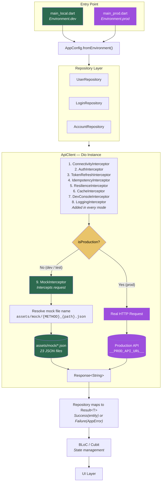
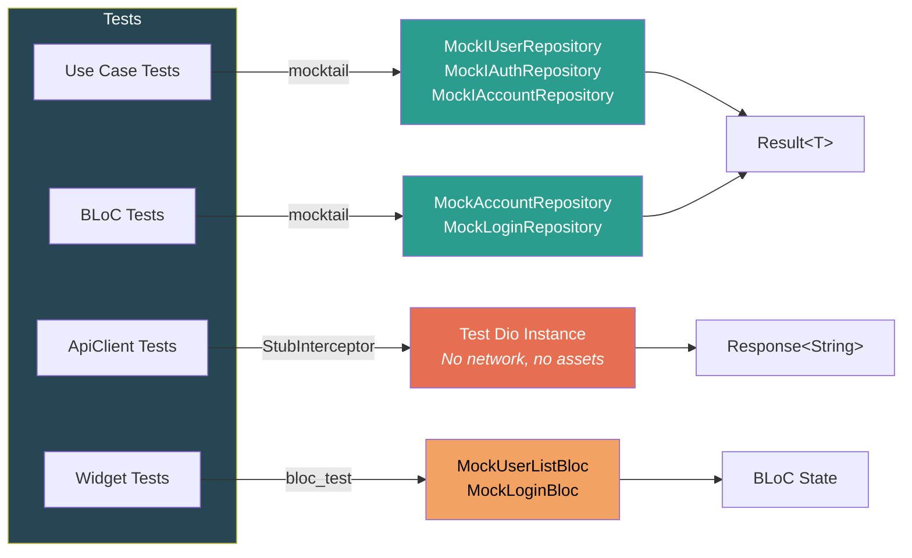

# Mock Data Architecture

This document explains how the project handles real API calls vs. local mock data, how mock JSON files are structured and resolved, and which tests use the mock data and which bypass it with test doubles.

## Overview

The project supports three runtime modes through a single interceptor-based design:

| Mode | Entry Point | Mock Data | Network | Latency |
| --- | --- | --- | --- | --- |
| **Development** | `main_local.dart` | Yes (interceptor) | None | 500 ms simulated |
| **Test** | `Environment.test` | Yes (interceptor) | None | 0 ms |
| **Production** | `main_prod.dart` | No | Real API | Real |

Switching between modes requires **zero code changes** in repositories or BLoCs — only the entry point differs.

## Architecture Diagram



### Test Layer (Test Doubles)



## Interceptor Chain

The Dio HTTP client is created in `lib/infrastructure/http/api_client.dart`.
`ApiClient._createDio()` pairs each interceptor with the metadata the system dashboard shows; without that metadata, the chain is:

```dart
dio.interceptors.addAll([
  ConnectivityInterceptor(),                      // rejects requests while offline
  AuthInterceptor(secureStorage: _secureStorage), // attaches the JWT
  TokenRefreshInterceptor(                        // refreshes expired access tokens
    dio: dio,
    onSessionExpired: _onSessionExpired,
    secureStorage: _secureStorage,
  ),
  IdempotencyInterceptor(),                       // opt-in Idempotency-Key for POST/PUT/PATCH
  ResilienceInterceptor.instance.forDio(dio),     // retry + circuit breaker
  CacheInterceptor(),                             // GET response caching with TTL
  DevConsoleInterceptor(),                        // records requests in debug builds
  LoggingInterceptor(),                           // request/response logging
  if (!_appConfig.isProduction) MockInterceptor(appConfig: _appConfig), // dev + test only
]);
```

Only `MockInterceptor` depends on the environment: it is added outside production, as the last entry.
It sits last because it stands in for the server: it resolves with `callFollowingResponseInterceptor: true`, so its response still runs through the `onResponse` handlers of the interceptors above it (cache, dev console, logging), as a real response would.
When it answers a protected request without a token with 401, it rejects with `callFollowingErrorInterceptor: true`, so the `onError` handlers run as they do for a server 401: `TokenRefreshInterceptor` ends the session when the token cannot be refreshed, and the dev console and logging record the failure.

`ConnectivityInterceptor` rejects with `callFollowingErrorInterceptor: true` as well when `ConnectivityService` reports the device offline, so the `onError` handlers run as they do for a request that cannot connect: `CacheInterceptor` answers a GET from its cache with an `x-cache: stale` header, and the dev console and logging record a request it cannot answer.
The error of that rejection is a `ConnectivityException`, so `ResilienceInterceptor` neither retries it nor counts it against the endpoint's circuit breaker: the request was never sent.

### AuthInterceptor

Reads the JWT from `ISecureStorage` on every request to a private path and adds it as a Bearer token when one is stored.
A request to a public path (see [Public vs. Private Paths](#public-vs-private-paths)) never gets a token:

```dart
if (isPublicEndpoint(options)) {
  handler.next(options);
  return;
}
String? jwtToken;
try {
  jwtToken = await _secureStorage.read(SecureStorageKeys.jwtToken.key);
} catch (e) {
  _log.warn('secure read failed for {}; sending request without Authorization: {}', [options.path, e]);
}
final hasAuth = jwtToken != null && jwtToken.isNotEmpty;
if (hasAuth) {
  options.headers['Authorization'] = 'Bearer $jwtToken';
}
```

This runs **before** MockInterceptor so that mock auth checks see the token.

### MockInterceptor

This is the core of the mock system.
In dev/test mode it answers every request that reaches the end of the chain with a response loaded from a local JSON file, so the request never leaves the device.

**Step-by-step flow:**

1. **Simulated latency** — 500 ms delay in dev mode, skipped in test mode
2. **Auth check** — For non-public paths, rejects with 401 if no `Authorization` header
3. **Status code** — POST → 201, DELETE → 204 (early return), everything else → 200
4. **File resolution** — Builds a file name from the request metadata (see next section)
5. **Asset loading** — Reads the JSON file via `rootBundle.loadString()`
6. **Fallback** — If the file does not exist, returns `"OK"` with the appropriate status code

### LoggingInterceptor

Logs the method and URI of each request, and the status code and body length of each response, via `AppLogger`.
Always runs, in every mode.

## Mock File Naming Convention

Mock JSON files served by `MockInterceptor` live in `assets/mock/` and follow a strict naming pattern:

```
{HTTP_METHOD}{path_with_underscores}[_pathParams|_queryParams].json
```

**Path transformation rules:**
- `/` → `_`
- `-` → `_`

**Examples:**

| Request | Mock File |
| --- | --- |
| `GET /account` | `GET_account.json` |
| `POST /authenticate` | `POST_authenticate.json` |
| `GET /admin/users/{id}` | `GET_admin_users_pathParams.json` |
| `GET /admin/users?page=0&size=10` | `GET_admin_users_queryParams.json` |
| `GET /admin/users/filter?name=John` | `GET_admin_users_filter_queryParams.json` |
| `PUT /admin/users` | `PUT_admin_users.json` |
| `POST /account/change-password` | `POST_account_change_password.json` |
| `DELETE /admin/users/{id}` | *(no file needed — returns 204 directly)* |

**How the file name is resolved** (from `MockInterceptor`):

```dart
final basePath = options.extra['_basePath'] ?? options.path;
final hasPathParams = options.extra['_pathParams'] != null;
final hasQueryParams = options.extra['_queryParams'] != null;
final filePath = basePath.replaceAll('/', '_').replaceAll('-', '_');

if (hasPathParams) {
  mockFileName = '${options.method}${filePath}_pathParams.json';
} else if (hasQueryParams) {
  mockFileName = '${options.method}${filePath}_queryParams.json';
} else {
  mockFileName = '${options.method}$filePath.json';
}
```

The `_basePath`, `_pathParams`, and `_queryParams` metadata are injected by `ApiClient` into `options.extra` so the interceptor can distinguish between `/admin/users` (list) and `/admin/users/123` (single item).

## Mock JSON File Structure

Each file contains the exact JSON the real API would return.

**Single object** (`GET_account.json`):
```json
{
  "id": "user-1",
  "login": "admin",
  "email": "admin@sample.tech",
  "firstName": "Admin",
  "lastName": "User",
  "activated": true,
  "langKey": "en",
  "createdBy": "system",
  "createdDate": "2024-01-04T06:02:47.757Z",
  "lastModifiedBy": "admin",
  "lastModifiedDate": "2024-01-04T06:02:47.757Z",
  "authorities": ["ROLE_ADMIN", "ROLE_USER"]
}
```

**Array** (`GET_admin_users_queryParams.json`):
```json
[
  { "id": "user-1", "login": "admin", "firstName": "Admin", ... },
  { "id": "user-2", "login": "new_user-2", "firstName": "Mock new user First Name", ... },
  ...
]
```

**Auth token** (`POST_authenticate.json`):
```json
{
  "id_token": "MOCK_TOKEN",
  "refresh_token": "MOCK_REFRESH_TOKEN"
}
```

## Public vs. Private Paths

Defined in `lib/core/security/allowed_paths.dart`:

**Public paths** (no JWT required):
- `/authenticate`, `/register`, `/logout`
- `/account/reset-password/init`, `/forgot-password`
- `/login-otp`, `/login-otp-verify`
- `/authenticate/send-otp`, `/authenticate/verify-otp`
- `/api/token/refresh`

All other paths require a valid `Authorization` header. In dev/test mode the `MockInterceptor` enforces this check; in production the real API does.

In every environment `AuthInterceptor` sends no token to a public path, so a stale token left by an expired session never reaches the sign-in endpoints.
`TokenRefreshInterceptor` passes a 401 from any other public path than the refresh endpoint on without a token refresh and without ending the session, because it rejects the credentials in the request, not a token; a 401 from the refresh endpoint still ends the session.

## How Repositories Use ApiClient

Repositories are **completely unaware** of whether they are running against mock data or a real API.
They receive the shared `ApiClient` through their constructor and always call it:

```dart
class UserRepository implements IUserRepository {
  UserRepository(this._apiClient);

  final ApiClient _apiClient;

  static const String _resource = 'users';

  @override
  Future<Result<UserEntity>> retrieve(String id) async {
    try {
      final response = await _apiClient.get('/admin/$_resource', pathParams: id);
      final result = User.fromJsonString(response.data!)!;
      return Success(result);
    } on UnauthorizedException catch (e) {
      return Failure(AuthError(e.toString()));
    } on FetchDataException catch (e) {
      return Failure(_mapFetchDataException(e)); // TimeoutError or NetworkError
    }
  }
}
```

The `pathParams: id` argument causes `ApiClient` to:
1. Build the URL as `/admin/users/{id}`
2. Store `_basePath: '/admin/users'` and `_pathParams: id` in `options.extra`
3. In dev mode, `MockInterceptor` reads `_pathParams`, resolves `GET_admin_users_pathParams.json`

## Menu: Direct Asset Read

The shell menu is the one exception where mock data is read outside the interceptor:

```dart
// lib/app/shell/repositories/menu_repository.dart
Future<List<Menu>> list() async {
  final json = await rootBundle.loadString('assets/mock/menus.json');
  final result = Menu.fromJsonStringList(json);
  return result;
}
```

`AppDependencies.createMenuRepository()` returns this repository in every environment, so the menu comes from the bundled `menus.json` in production too.
Because the file never goes through `ApiClient`, its name does not follow the `{METHOD}_{path}` convention.

## Test Layer

Most tests do **not** use the mock interceptor.
They replace a layer with a test double instead:

```
┌──────────────────────────────────────────────────────────────────┐
│                        Test Layer                                 │
│                                                                   │
│  Use Case Tests:   MockIUserRepository (interface mock)          │
│  BLoC Tests:       MockAccountRepository (concrete mock)         │
│  ApiClient Tests:  _StubInterceptor (Dio-level stub)             │
│  Widget Tests:     MockBloc (bloc_test)                          │
└──────────────────────────────────────────────────────────────────┘
```

Two common setups do run the mock interceptor.
`TestEnv.apiClient()`, which repository tests use, builds an `ApiClient` with `AppConfig.test()`, so `MockInterceptor` serves `assets/mock/*.json` without the simulated latency.
Passing a stub `dio` to it replaces the whole chain, `MockInterceptor` included.
A test that pumps the whole `App` with its default `AppDependencies`, such as `test/integration/app_smoke_test.dart`, runs with `AppConfig.dev()`, the same `AppConfig` as `main_local.dart`.

### Use Case Tests

Mock the repository interface directly. No HTTP involved:

```dart
class MockIUserRepository extends Mock implements IUserRepository {}

test('fetches user by id', () async {
  when(() => mockRepo.retrieve('1'))
      .thenAnswer((_) async => const Success(user));

  final result = await useCase.call('1');
  expect(result, isA<Success<UserEntity>>());
});
```

### BLoC Tests

Mock the repository (or use case) and verify state transitions:

```dart
blocTest<UserEditorBloc, UserEditorState>(
  'emits [loading, loaded] when fetch succeeds',
  build: () {
    when(() => mockRepo.retrieve('1'))
        .thenAnswer((_) async => const Success(user));
    return UserEditorBloc(
      fetchUserUseCase: FetchUserUseCase(mockRepo),
      saveUserUseCase: SaveUserUseCase(mockRepo),
    );
  },
  act: (bloc) => bloc.add(const UserEditorFetch('1')),
  expect: () => [
    const UserEditorLoading(),
    const UserEditorLoaded(data: user),
  ],
);
```

### ApiClient Tests

`ApiClient` is constructed via dependency injection — there is no global
singleton or `setTestInstance`. Inject a custom `_StubInterceptor` through the
`dio` parameter to simulate transport errors:

```dart
setUp(() {
  stub = _StubInterceptor();
  final testDio = Dio(BaseOptions(baseUrl: 'https://test.api', responseType: ResponseType.plain));
  testDio.interceptors.add(stub);
  client = ApiClient(appConfig: const AppConfig.prod(), dio: testDio);
});

test('maps 401 to UnauthorizedException', () async {
  stub.stubDioError(DioExceptionType.badResponse, statusCode: 401);
  expect(() => client.get('/endpoint'), throwsA(isA<UnauthorizedException>()));
});
```

### Test Bootstrap

Cross-cutting test setup is centralized in `test/flutter_test_config.dart`
(auto-discovered by `flutter test`), which runs once-per-isolate config and an
automatic per-test environment reset via `TestEnv` (`test/support/test_env.dart`).
Individual test files need no manual storage/router/secure-storage setup; use
`TestEnv.authenticate()` (in `setUp`/test body) for auth-dependent tests and
`TestEnv.apiClient({Dio? dio})` for the mock-backed client.

See [`testing-architecture.md`](testing-architecture.md) for the full test
structure, bootstrap, opt-out mechanism, and per-layer test patterns.

## Adding a New Mock Endpoint

When you add a new API endpoint, follow these steps:

1. **Create the mock JSON file** in `assets/mock/` following the naming convention:
   ```
   GET_your_endpoint.json              — for GET without params
   GET_your_endpoint_pathParams.json   — for GET with path params
   GET_your_endpoint_queryParams.json  — for GET with query params
   POST_your_endpoint.json             — for POST
   PUT_your_endpoint.json              — for PUT
   ```

2. **Register the asset** in `pubspec.yaml` (already covered by `assets/mock/` glob).

3. **If the endpoint is public**, add the path to `lib/core/security/allowed_paths.dart`.

4. **Call `ApiClient`** from your repository — the mock interceptor handles the rest automatically.

No changes to `MockInterceptor` or `ApiClient` are needed.

## File Reference

| Purpose | Path |
| --- | --- |
| Environment config | `lib/infrastructure/config/environment.dart` |
| API client + Dio factory | `lib/infrastructure/http/api_client.dart` |
| Auth interceptor | `lib/infrastructure/http/interceptors/auth_interceptor.dart` |
| Mock interceptor | `lib/infrastructure/http/interceptors/mock_interceptor.dart` |
| Logging interceptor | `lib/infrastructure/http/interceptors/logging_interceptor.dart` |
| Public path definitions | `lib/core/security/allowed_paths.dart` |
| Template config (API URL) | `lib/infrastructure/config/template_config.dart` |
| Mock JSON files | `assets/mock/*.json` (23 files) |
| DI (ApiClient + repository factories) | `lib/app/di/app_dependencies.dart` |
| Test utilities | `test/support/test_env.dart` |
| Mock classes | `test/mocks/mock_classes.dart` |
| ApiClient tests | `test/infrastructure/http/api_client_test.dart` |
